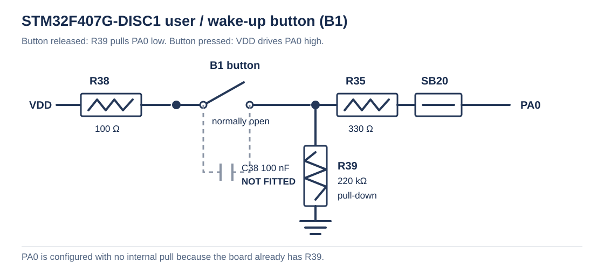
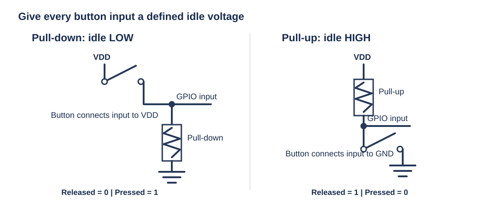
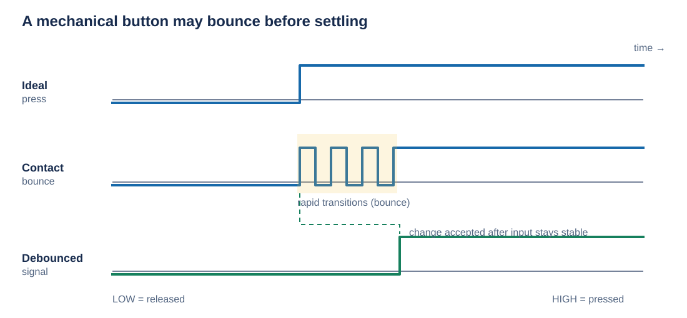

# GPIO Driver Button-Controlled LED for STM32F407VG

This project extends the register-level GPIO driver examples by reading the user button on `PA0` and controlling the orange LED on `PD13`. The button input is configured without an internal pull-up or pull-down because the board circuitry already provides an external pull-down resistor.

## Project objective

The firmware demonstrates how to:

- configure `PA0` as a digital input
- read the button state using the GPIO driver
- drive the `PD13` LED according to the button state
- understand switch bounce and why an input needs a defined idle voltage

## Hardware target

- Board: STM32F407G-DISC1 Discovery Board
- MCU: STM32F407VG
- Toolchain: STM32CubeIDE / GCC ARM Embedded
- User button: `PA0`
- Orange user LED: `PD13`

## Project structure

```text
0011_GPIO_Driver_Button_LED/
├── Startup/
│   └── startup_stm32f407vgtx.s
├── Src/
│   ├── main.c
│   ├── syscalls.c
│   └── sysmem.c
├── drivers/
│   ├── Inc/
│   │   ├── gpiodriver.h
│   │   └── stm32f407xx.h
│   └── Src/
│       └── gpiodriver.c
├── Images/
│   ├── button_input_circuit.svg
│   ├── button_pullup_pulldown.svg
│   └── button_debounce_waveform.svg
├── STM32F407VGTX_FLASH.ld
├── STM32F407VGTX_RAM.ld
└── README.md
```

## Button circuit and input configuration

As shown in the board schematic, the user button drives `PA0` high when pressed. The input has an external `220 kΩ` pull-down (`R39`), and the button's high path includes `R38` (`100 Ω`) and `R35` (`330 Ω`):



The schematic also shows `C38` (`100 nF`) as **Not Fitted**, so it does not provide hardware filtering or debouncing on this board as configured. Since the board already supplies the `R39` pull-down path, the firmware sets `pinPullUpPullDown` to `GPIO_NO_PULL_UP_DOWN`. An internal pull-up would oppose the external pull-down; an internal pull-down is unnecessary.

### Why a pull-up or pull-down is needed

A button input that is not connected to a defined logic level can float. A floating input may pick up electrical noise and randomly read as either `0` or `1`, even when the button is not pressed. A pull resistor provides a weak, defined default level while still allowing the button to drive the opposite level:



If a circuit has no external pull resistor, enable the matching internal GPIO pull-up or pull-down, or add an external resistor. Choose the resistor direction to match how the button connects the pin when pressed. Do not leave the input floating, and avoid configuring opposing pull directions.

## Switch debouncing

Mechanical button contacts do not switch cleanly in one instant. As the contacts touch or separate, they can bounce for a short time, creating several fast transitions instead of one stable edge. The schematic's `C38` capacitor could provide hardware filtering if fitted as designed, but it is marked **Not Fitted**, so this project relies on software and has no fitted capacitor debounce:



Without debouncing, one physical press may be interpreted as multiple presses or produce flickering output. This project adds a software delay after sampling the input, which slows polling and can reduce the effect of brief bounce. It is a simple demonstration rather than a complete debounce algorithm: the program does not verify that the input remains unchanged for a defined stability interval. A more reliable approach samples again after a debounce interval and accepts the new state only if both readings agree (or uses a timer to require a continuously stable state).

## Application logic

`Src/main.c` enables the GPIOA and GPIOD clocks, configures `PA0` as an input with no internal pulls, and configures `PD13` as a push-pull output. The loop reads `PA0`; a high reading turns on the LED, and a low reading turns it off.

## Build and usage

1. Open the project in STM32CubeIDE.
2. Ensure `drivers/Inc` is included in the compiler include paths.
3. Build and flash the firmware to the STM32F407G-DISC1 board.
4. Press and release the user button; the orange LED should follow its state.

## Summary

The example shows a button input controlling an LED through the custom GPIO driver. The external pull-down already on the board gives `PA0` a stable low state when idle, so no internal pull is needed. Pull resistors prevent floating inputs, while debouncing prevents rapid contact transitions from being mistaken for multiple or unstable button events.
