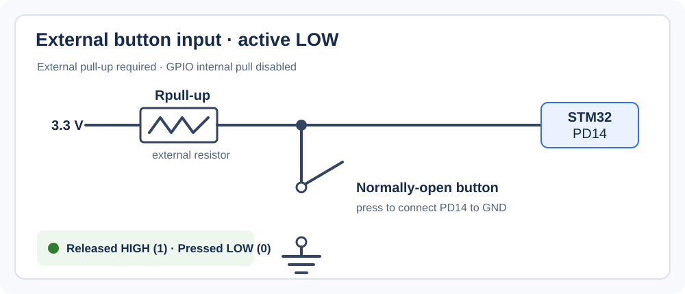
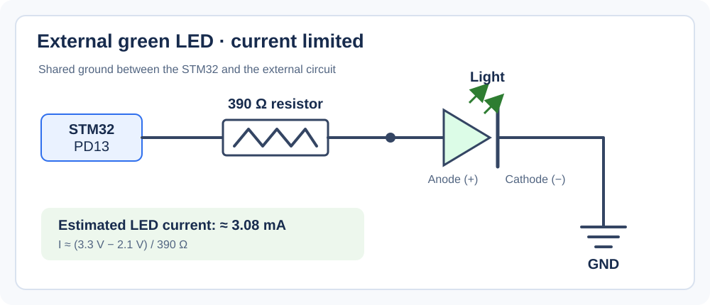

# External Button and LED with the STM32 GPIO Driver

This project uses the custom GPIO driver to read an external push button on
`PD14` and control an LED on `PD13` on the STM32F407G-DISC1. The button is
active-low: it reads high while released and low while pressed. The external
button circuit uses a pull-up configuration.

## Hardware and pin configuration

- Board: STM32F407G-DISC1 Discovery Board
- MCU: STM32F407VG
- Button input: `PD14` (GPIOD pin 14)
- LED output: `PD13` (GPIOD pin 13; also connected to the board's orange LED)
- Supply: 3.3 V

### Button wiring

Connect the button input so it has a defined high level when released and is
connected to ground when pressed:



The resistor is an external pull-up in this circuit. In `Src/main.c`, the
GPIO's internal pull-up and pull-down are both disabled
(`GPIO_NO_PULL_UP_DOWN`), so the external pull-up must be present for a stable
released state. The input should not be left floating.

### LED wiring

Connect `PD13` to the LED in series with a current-limiting resistor, with the
LED oriented for forward current when the pin is high:



The resistor may be placed on either side of the LED as long as they are in
series. Connect the STM32 ground and external circuit ground together.

## Firmware behavior

`Src/main.c` enables the GPIOD clock, configures `PD13` as a push-pull output,
and configures `PD14` as an input without an internal pull. The loop reads
`PD14`: a low reading turns `PD13` high, and a high reading turns it low. The
firmware includes a delay after each input sample to slow polling, but this is
not a complete software debounce algorithm.

## LED current estimate

For a 3.3 V GPIO output and a green LED forward voltage of approximately 2.1 V,
the resistor drops about 1.2 V. Ohm's law gives the approximate LED current:

```text
I = (VCC - VF) / R
```

| Series resistor | Estimated current | Observation |
| --- | ---: | --- |
| 5.6 kΩ | 1.2 V / 5,600 Ω ≈ 0.21 mA | May be too dim to see reliably |
| 390 Ω | 1.2 V / 390 Ω ≈ 3.08 mA | Visible LED current in this setup |

These are estimates; the actual current depends on the LED's forward voltage
and the GPIO output voltage under load. The 390 Ω resistor limits current; do
not connect an LED directly to a GPIO. Keep pin and aggregate port currents
within the STM32F407 datasheet limits.

## Troubleshooting notes

During initial hardware testing, the firmware and onboard debug LEDs indicated
that the button was changing the GPIO state, but the external LED did not
illuminate. The problem was traced to three separate hardware issues:

| Stage | Observation | Cause | Fix |
| --- | --- | --- | --- |
| Initial setup | Onboard LEDs responded to the button; external LED stayed off. | The external LED was reversed, blocking forward current. | Reorient it with its anode toward the output/resistor and cathode toward ground. |
| Second test | LED still did not illuminate. | A breadboard air gap left the resistor and LED in different connected rows. | Move the components so their leads share a connected row and verify the full series path. |
| Final test | Circuit continuity was restored, but the LED was still too dim or appeared off. | The 5.6 kΩ resistor limited current to approximately 0.21 mA. | Replace it with 390 Ω; estimated current is approximately 3.08 mA. |

After correcting LED polarity, breadboard continuity, and the resistor value,
the external LED illuminated in sync with the firmware output. When debugging
a non-working LED, verify its polarity, the breadboard's connected rows and
gaps, a shared ground, and the resistor value before assuming the GPIO code is
at fault.

## Build and run

1. Open the project in STM32CubeIDE.
2. Build and flash the firmware to the STM32F407G-DISC1.
3. Connect the external button to `PD14` using the pull-up wiring above, and
   connect the external LED circuit to `PD13`.
4. Press the button. The external LED and the board's `PD13` LED should turn on
   while the button is pressed and turn off when released.
