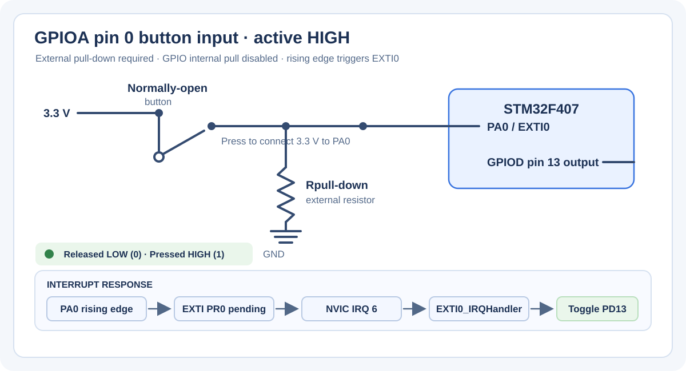

# STM32F407 GPIO Driver Configuration

This STM32CubeIDE project is a bare-metal GPIO driver exercise for the
STM32F407VGTx, configured for the STM32F407G-DISC1 board. It implements GPIO
register access directly, without the STM32 HAL. The application configures
GPIOD pin 13 as an LED output and GPIOA pin 0 as an EXTI input. Its intended
behavior is to toggle the LED when an EXTI0 interrupt occurs.

This document describes the logic in the project as it is currently written.
The final section calls out implementation limitations that can affect whether
the interrupt demo works as intended.

## Project layout

| Path | Purpose |
| --- | --- |
| `Src/main.c` | Application setup, GPIO selections, NVIC setup, and EXTI0 interrupt service routine. |
| `drivers/Inc/gpiodriver.h` | GPIO configuration/handler types, configuration constants, and driver API declarations. |
| `drivers/Src/gpiodriver.c` | GPIO clock, initialization, reset, input/output, and interrupt helper implementations. |
| `drivers/Inc/stm32f407xx.h` | STM32F407 peripheral addresses, volatile register layouts, peripheral aliases, and low-level bit definitions. |
| `Startup/startup_stm32f407vgtx.s` | Cortex-M4 reset entry, vector table, and weak default interrupt handlers. |
| `STM32F407VGTX_FLASH.ld` | Flash-execution linker script and Flash/RAM memory layout. |
| `STM32F407VGTX_RAM.ld` | Alternative linker script that places code in RAM for debugging. |
| `Src/syscalls.c` | Minimal Newlib system-call stubs supplied by STM32CubeIDE. |
| `Src/sysmem.c` | Newlib heap-growth implementation using the linker-defined RAM boundaries. |
| `images/gpioa0-exti0-diagram.svg` | Wiring and interrupt-response diagram for the PA0-to-EXTI0 button example. |
| `.project`, `.cproject`, `0008_GPIO_Driver_Configuration.launch` | STM32CubeIDE project, target/build settings, and launch configuration. |
| `Debug/` | Generated build makefiles, object files, and build outputs; these are not the driver source of record. |

## Hardware and peripheral model

The code targets the STM32F407VGTx, an ARM Cortex-M4 device. The low-level
header maps peripheral base addresses to C structures whose members correspond
to hardware registers. For example, the GPIO structure represents `MODER`,
`OTYPER`, `OSPEEDR`, `PUPDR`, `IDR`, and `ODR`. Each register is declared
`volatile` because reads and writes must reach the peripheral and must not be
optimized away as ordinary memory operations.

The same header defines the base addresses and register structures for RCC,
EXTI, and SYSCFG. The driver uses these to:

1. Enable GPIO peripheral clocks through RCC's AHB1 enable register.
2. Set GPIO mode and electrical configuration in the GPIO registers.
3. Route a GPIO pin to an EXTI line through SYSCFG.
4. Select EXTI trigger edges and mask/unmask the EXTI line.
5. Enable and prioritize the corresponding interrupt in the Cortex-M NVIC.

The pin configuration values in `gpiodriver.h` mirror the two-bit GPIO mode
encoding: input, output, alternate function, and analog. Additional values
represent rising-edge, falling-edge, or both-edge interrupt configurations.
Output type, output speed, pull configuration, pin number, and alternate
function number are held together in `GPIO_PinConfig_t`. `GPIO_Handler_t`
combines that configuration with a pointer to the selected GPIO peripheral,
so the same driver API can configure different ports and pins.

The public configuration constants are:

| Category | Values |
| --- | --- |
| GPIO mode | `GPIO_MODE_IN` = 0, `GPIO_MODE_OUT` = 1, `GPIO_MODE_ALTFUN` = 2, `GPIO_MODE_ANALOG` = 3 |
| EXTI trigger mode | `GPIO_MODE_RET` = 4 (rising), `GPIO_MODE_FET` = 5 (falling), `GPIO_MODE_RFET` = 6 (both edges) |
| Output type | `GPIO_OUTPUT_TYPE_PUSHPULL` = 0, `GPIO_OUTPUT_TYPE_OPENDRAIN` = 1 |
| Output speed | `GPIO_OUTPUT_SPEED_LOW` = 0, `GPIO_OUTPUT_SPEED_MEDIUM` = 1, `GPIO_OUTPUT_SPEED_HIGH` = 2, `GPIO_OUTPUT_SPEED_VERYHIGH` = 3 |
| Pull configuration | `GPIO_NO_PULL_UP_DOWN` = 0, `GPIO_PULL_UP` = 1, `GPIO_PULL_DOWN` = 2 |
| Pin constants | `GPIO_PIN_0` through `GPIO_PIN_15` represent the hardware pin numbers; `GPIO_PIN_16` is also defined in the header but is not a valid GPIO pin on these ports. |

The driver API is declared in `gpiodriver.h`. `GPIO_CLKControl` controls a port
clock; `GPIO_Init` applies a `GPIO_Handler_t` configuration;
`GPIO_DeInit` requests a peripheral reset; `GPIO_ReadPortPin` and
`GPIO_ReadPort` read `IDR`; `GPIO_WritePortPin`, `GPIO_WritePort`, and
`GPIO_TogglePin` update `ODR`; `GPIO_IRQInterruptConfig` enables or disables
an NVIC IRQ; `GPIO_IRQPriority` sets its priority; and `GPIO_Handler` clears
the pending EXTI line. The functions return `void` except for the read helpers,
which return the sampled pin or port value.

## Application flow

### Initialization in `main`

`main` clears the two global handler structures with `memset`. This gives
their configuration fields deterministic initial values before assigning the
fields used by this demo.

It then enables the clocks for GPIOD and GPIOA, because the application uses
the LED output on GPIOD and the button input on GPIOA. A peripheral clock must
be enabled before its registers can be configured or used.

The LED handler is configured as follows:

| Setting | Value | Meaning |
| --- | --- | --- |
| Port | GPIOD | LED GPIO port. |
| Pin | 13 | LED output pin selected by this example. |
| Mode | `GPIO_MODE_OUT` | General-purpose output. |
| Output type | `GPIO_OUTPUT_TYPE_PUSHPULL` | Drives both high and low levels. |
| Speed | `GPIO_OUTPUT_SPEED_MEDIUM` | Selects the medium GPIO output slew-rate setting. |
| Pull | `GPIO_NO_PULL_UP_DOWN` | No internal pull resistor. |

The button handler is configured for GPIOA pin 0 with `GPIO_MODE_RET`. In this
driver, `GPIO_MODE_RET` means an EXTI input with a rising-edge trigger; it is
not a GPIO mode-register value. The configuration requests high speed and no
internal pull-up/pull-down. `GPIO_Init` is then called for each handler.

After GPIO setup, `main` assigns priority 15 to EXTI0 and enables IRQ number 6
in the NVIC. On this Cortex-M configuration, lower priority values represent
higher urgency, so 15 is a low urgency priority. The foreground then enters
`while (1);` and does no further work; the example is interrupt-driven.

The register fields used during initialization have fixed hardware widths:
`MODER`, `OSPEEDR`, and `PUPDR` use two bits per pin; `OTYPER` uses one bit per
pin; and each `AFR` entry uses four bits per pin. For EXTI routing, integer
division by four selects one of the four `EXTICR` registers, and the remainder
selects that register's four-bit line field. The NVIC priority helper likewise
groups four IRQ priorities into each 32-bit priority word and selects one byte
for the requested IRQ.

### Interrupt and LED toggle

The diagram shows the electrical input and the event-to-LED response in one
view. It is adapted to this project's actual GPIOA pin 0 and rising-edge
configuration, rather than copying the reference image's active-LOW wiring.

This is an **active-HIGH** circuit: the external normally-open button connects
PA0 to 3.3 V when pressed, and an external pull-down resistor holds PA0 low
when released. The code disables internal pulls, so the external resistor is
needed to define the released input level. Pressing the button creates the
rising edge selected by `GPIO_MODE_RET`, which matches the current driver
configuration. The illustrative wiring assumes the button and resistor are
actually connected this way; the source code alone cannot establish the
board's physical wiring.

The lower sequence in the diagram represents the response path: EXTI records
the event in `PR0`, the NVIC delivers IRQ 6, the vector table selects
`EXTI0_IRQHandler`, and the ISR acknowledges the event and toggles GPIOD pin
13. Before that event path can work, `main` enables GPIOA, calls
`GPIO_Init(&Button)` to set the edge, source routing, and EXTI mask, sets IRQ 6
priority to 15, then enables IRQ 6. The foreground subsequently waits in
`while (1)`.

### Interrupt path, step by step

1. **Configure the source.** `GPIO_Init(&Button)` is called with GPIOA, pin 0,
   and `GPIO_MODE_RET`. The driver interprets this mode as rising-edge EXTI:
   it enables bit 0 in EXTI's rising trigger selection register (`RTSR`), clears
   bit 0 in the falling trigger selection register (`FTSR`), selects GPIOA as
   the source for EXTI line 0 in `SYSCFG->EXTICR[0]`, and unmasks line 0 in
   `EXTI->IMR`.
2. **Enable delivery to the processor.** `main` sets priority for IRQ number 6
   and enables it via `GPIO_IRQInterruptConfig`. The EXTI peripheral can
   therefore request the EXTI0 interrupt from the NVIC, and the NVIC can
   forward it when it is enabled and eligible under the current priority and
   processor state.
3. **Detect a transition.** When the selected edge occurs on PA0, EXTI sets
   pending bit 0 in `EXTI->PR`. This records the event even if the CPU cannot
   service it immediately. The `IMR` bit gates whether EXTI sends an interrupt
   request to the NVIC; it does not itself clear the pending bit.
4. **Accept the exception.** Once the NVIC presents an enabled, eligible IRQ,
   the Cortex-M4 pauses the foreground instruction stream and automatically
   saves the return address and processor state on the active stack. It uses
   the EXTI0 slot in the vector table to obtain the handler address. The
   startup file provides a weak default for this vector, but the application's
   strong `EXTI0_IRQHandler` replaces it at link time.
5. **Run the application handler.** `EXTI0_IRQHandler` performs a fixed
   iteration busy wait, calls `GPIO_Handler(GPIO_PIN_0)` to check and clear
   EXTI pending bit 0, and calls `GPIO_TogglePin(GPIOD, GPIO_PIN_13)`. Toggling
   is implemented as XOR against `ODR` bit 13, so each handled interrupt
   changes the LED output from low to high or high to low.
6. **Return to foreground.** When the handler returns, the Cortex-M4 restores
   the saved processor state and resumes the interrupted code. In this example,
   foreground execution was the infinite `while (1);` loop, so it resumes
   there and waits for another interrupt.

### What the Cortex-M4 processor does when an interrupt occurs

The GPIO/EXTI peripheral detects the electrical event, but the Cortex-M4
processor and NVIC perform the exception handling. These are separate steps:
EXTI remembers the peripheral event in its pending register, while the NVIC
tracks and prioritizes the interrupt request presented to the processor.

1. **The peripheral raises a request.** A configured PA0 transition sets EXTI
   pending bit `PR0`. If EXTI line 0 is unmasked in `IMR`, the EXTI peripheral
   asserts its EXTI0 interrupt request to the NVIC. The pending bit records the
   source event; it is not the processor's saved CPU context.
2. **The NVIC records and arbitrates.** The NVIC marks the request pending,
   then checks that IRQ 6 is enabled and eligible. Eligibility depends on the
   current execution priority and processor masks (for example, a higher
   priority active exception can delay a lower-priority IRQ). Here IRQ 6 is
   assigned priority 15, which is the lowest urgency among the implemented
   priority levels.
3. **The processor finishes the current instruction.** The processor does not
   normally interrupt halfway through an instruction. At an instruction
   boundary, if the request remains eligible, it accepts the interrupt as an
   exception. The foreground code stops temporarily; it is not discarded.
4. **The processor saves the interrupted context automatically.** On exception
   entry, hardware pushes the basic exception stack frame to the active stack:
   `R0`-`R3`, `R12`, `LR`, the return `PC`, and `xPSR`. The stack in use depends
   on the interrupted context: Thread mode can use MSP or PSP, while Handler
   mode uses MSP. The processor also sets `LR` to an `EXC_RETURN` value that
   tells it how to return. Compiler-generated ISR code may save additional
   registers that the C handler uses; those are separate from the hardware
   exception frame.
5. **The processor dispatches through the vector table.** It obtains the
   handler address from the exception vector slot for EXTI0. In this project,
   the startup assembly defines that slot and a weak default handler; the
   strong `EXTI0_IRQHandler` in `main.c` is used instead.
6. **The handler services the source.** The CPU executes the ISR on the
   Handler-mode stack. This handler busy-waits, checks and acknowledges EXTI
   `PR0` through `GPIO_Handler`, and toggles GPIOD `ODR` bit 13. Clearing the
   source is important: if an interrupt source remains asserted or pending,
   the NVIC may present the IRQ again after exception return.
7. **The processor returns from the exception.** When the ISR returns, its
   `EXC_RETURN` behavior tells the processor to unstack the saved frame, restore
   the prior execution mode and stack, and continue at the saved `PC`. The
   main loop then resumes. If another eligible interrupt is pending at this
   point, the Cortex-M can enter that handler immediately (tail-chaining)
   instead of first returning to foreground code and stacking again.

For this application, `main` runs in Thread mode and does not explicitly
switch to the process stack, so it normally uses the main stack (MSP). The
ISR runs in Handler mode and uses MSP as well. The CPU context frame and the
EXTI/NVIC pending state serve different purposes: the frame allows execution
to resume, while the pending state ensures the event is delivered or remains
recorded until it can be handled.

The pending-bit acknowledgement matters: EXTI pending status is
write-one-to-clear. The intended operation is to write a one only to the bit
being acknowledged. The current `GPIO_Handler` first reads `PR` and then uses
`EXTI->PR |= (1 << pinNumber)`. That read-modify-write can write ones back to
other pending bits and clear them too. A safer implementation would write the
target mask directly to `PR`.

The delay loop is intended as a simple switch-debounce measure. It is a
processor-speed-dependent busy wait, not a time-calibrated debounce mechanism.
The main loop does not poll the button; interrupt configuration and the ISR
are the complete button event path.

### Requirements for the interrupt path to work

All of the following are required; configuring only the GPIO edge is not
sufficient:

| Layer | Required state | Configured by this project |
| --- | --- | --- |
| GPIO pin | PA0 available as an input and wired to a signal with a defined idle level. | `GPIO_Init` selects EXTI mode, but does not explicitly write PA0's `MODER`; reset state is relied on. No internal pull is requested. |
| EXTI edge detector | Rising-edge selection enabled for line 0, with falling edge disabled for this example. | `GPIO_Init` updates `RTSR` and `FTSR`. |
| EXTI source routing | EXTI line 0 connected to GPIOA. | `GPIO_Init` writes `SYSCFG->EXTICR[0]`, but `main` does not enable the SYSCFG peripheral clock first. |
| EXTI interrupt mask | `IMR` bit 0 set. | `GPIO_Init` unmasks line 0. |
| NVIC | EXTI0 IRQ number 6 enabled and assigned a priority. | `main` sets priority and enables IRQ 6. |
| ISR and vector | Vector entry resolves to `EXTI0_IRQHandler`. | Startup vector plus the application's strong handler. |
| Acknowledgement | Pending bit 0 cleared in `EXTI->PR`. | `GPIO_Handler` attempts to clear it, with the read-modify-write caveat above. |

If any gate is closed—for example, if the SYSCFG clock is disabled or the
NVIC interrupt is not enabled—the signal may set or retain pending state
without reaching the LED toggle code. A held button or contact bounce can also
produce repeated transitions; the busy wait in this ISR does not robustly
filter them.

For the processor-side exception model, see Arm's [Cortex-M4 Devices Generic
User Guide](https://support.arm.com/documentation/dui0553/latest/). For the
STM32F407 peripheral register behavior, consult ST's [STM32F405/407 reference
manual (RM0090)](https://www.st.com/resource/en/reference_manual/dm00031020.pdf),
particularly the GPIO, SYSCFG, EXTI, RCC, and interrupt chapters. The links
provide the device-level background; the flow above describes how this
project's source configures and uses those blocks.

## GPIO driver logic

### Clock control

`GPIO_CLKControl` compares the supplied peripheral pointer against GPIOA
through GPIOI. Depending on the requested enable/disable state, it sets or
clears the matching bit in RCC's AHB1 peripheral clock enable register. This
keeps the public API expressed in terms of GPIO peripheral pointers rather
than requiring callers to know RCC bit numbers.

### Pin initialization

`GPIO_Init` has two paths based on the configured mode:

* For mode values from `GPIO_MODE_IN` through `GPIO_MODE_ANALOG`, it shifts the
  mode value into the two-bit `MODER` field for the selected pin.
* For the interrupt mode values, it configures EXTI edge selection. Rising
  mode enables `RTSR` and disables `FTSR`; falling mode enables `FTSR` and
  disables `RTSR`; the remaining interrupt mode enables both edges. It derives
  the appropriate SYSCFG `EXTICR` register and four-bit field from the pin
  number, selects the GPIO port, and unmasks the EXTI line in `IMR`.

After that mode-specific work, initialization configures the pin's output type,
speed, and pull-up/pull-down fields. For alternate-function mode it also
selects one of the two AFR registers and writes the selected four-bit alternate
function field. This puts the common electrical settings and the mode-specific
settings in one handler-driven API.

### Port reset

`GPIO_DeInit` maps the port pointer to an index and invokes a helper that
asserts and deasserts a reset bit. This is intended to restore a GPIO
peripheral to its reset state without manually clearing every configuration
register.

### Input and output access

* `GPIO_ReadPortPin` shifts the input data register (`IDR`) by the pin number
  and masks bit 0 to return a single pin state.
* `GPIO_ReadPort` returns the low 16 bits of `IDR`, representing all GPIO pin
  input states.
* `GPIO_WritePortPin` sets or clears one bit in the output data register
  (`ODR`), preserving other output bits.
* `GPIO_WritePort` replaces the low 16 output bits with the supplied value.
* `GPIO_TogglePin` XORs the selected `ODR` bit, changing a high output to low
  or low to high while leaving other bits unchanged.

These APIs write `ODR` directly. They do not check that a pin is configured as
an output or validate a pin number.

### NVIC and EXTI helpers

`GPIO_IRQInterruptConfig` divides an IRQ number into groups of 32 and sets the
corresponding bit in an NVIC Interrupt Set-Enable Register (`ISER`) or Clear-
Enable Register (`ICER`). The current application uses IRQ 6, so it uses the
first register.

`GPIO_IRQPriority` computes which byte in the NVIC priority register array
contains the requested IRQ's priority field, then shifts the priority into
position. The device header declares four implemented priority bits.

`GPIO_Handler` checks the EXTI pending register for the requested line and
writes a one to that bit to clear the pending condition. The application then
toggles the LED in its IRQ-specific handler.

## Startup, memory, and build

The startup assembly initializes the stack pointer, calls `SystemInit`, copies
initialized data from its Flash load address to RAM, zeros the BSS region,
runs C library constructors, and calls `main`. It provides the device vector
table, including EXTI0, and weak aliases for the other handlers to a default
infinite-loop handler. The strong `EXTI0_IRQHandler` defined in `main.c`
overrides the startup weak alias.

The Flash linker script places the vector table, code, and read-only data in
Flash at `0x08000000`, with initialized data and BSS in the 128 KiB RAM region.
It also defines stack and heap reservations and the symbols used by startup
and `sysmem.c`. The alternative RAM linker script places executable sections
in RAM and is provided for RAM-based debugging. The active CubeIDE Debug build
uses the Flash linker script.

The generated Debug makefiles compile `main.c`, `gpiodriver.c`, startup
assembly, and the Newlib support files using the ARM GCC toolchain for Cortex-M4
and link an ELF executable. The `Debug/` directory contains generated build
artifacts and makefiles; the driver/application implementation lives in
`Src/` and `drivers/`.

`syscalls.c` supplies minimal stubs for system calls expected by Newlib. Its
weak `_read` and `_write` functions use `__io_getchar` and `__io_putchar` if
the application provides them; most other operations return unsupported
results. `sysmem.c` implements `_sbrk`, growing the heap from the linker symbol
`_end` while refusing growth into the reserved stack area.
